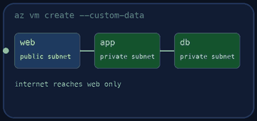
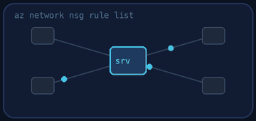
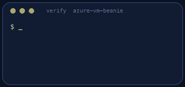
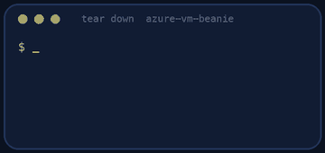

<p align="center"></p>

| | |
|-|-|
| **Time** | 105-120 min |
| **Cost** | a few cents (one small VM for two hours) |
| **You need** | An Azure subscription where you can create resources, the Azure CLI (`az login` done), an SSH client, curl, Python 3 and a terminal |

## How this lab works

1. **Fork** this repository to your own GitHub account (button at the top right).
2. Clone **your fork** in your Ubuntu environment (WSL on Windows, your OrbStack machine on Mac).
3. Read the lab below (the same text is in [`LAB.md`](LAB.md)) and follow the mission.
4. Answer the questions in [`SUBMISSION.md`](SUBMISSION.md). Where a question asks for output, paste it in a code block. No screenshots needed.
5. Commit and push. Open the **Actions** tab of your fork (click *I understand my workflows, go ahead and enable them* the first time). The **Lab check** shows what is still missing.
6. When the check is green, **submit the URL of your fork** in the course platform.

> [!NOTE]
> The check only looks at your answers and any files the lab asks you to commit. Your instructor reads your work and may ask you to explain any line.

<p align="center"></p>

## 🎬 The situation

<p align="center"></p>

A new client lives on Microsoft Azure, and they do not care what you know about AWS. They want Beanie, the cafe ordering system, running on **one Linux virtual machine** by the end of the day, reachable by customers on one port and by you on another, and nothing else. Nobody should have to log in to install it: if the VM is deleted, a new one must come up already running Beanie.

You know the ideas from AWS: a network, a firewall, a public address, a server. Azure has its own names, its own defaults and a few traps. Today you map one to the other, build the thing with the `az` CLI, and prove from the internet that the right doors are open and the others are shut.

> [!IMPORTANT]
> **Your mission**
> - Create a resource group, a virtual network, a Network Security Group (NSG), a public IP and a VM, with the `az` CLI
> - Make the VM install and start Beanie by itself on first boot, with **cloud-init**
> - Open port 8000 to everyone and SSH to **your address only**; keep every other port shut
> - Check the result the way a customer and an attacker would
> - Delete everything and prove it

**Time:** 105-120 min | **Cost:** a few cents (one small VM for two hours) | **You need:** an Azure subscription where you can create resources, the Azure CLI logged in (`az login`), an SSH client, curl, Python 3 and a terminal.

<p align="center"></p>

## Part 0 - Prepare

Fork this repository, clone your fork and run:

```bash
./setup.sh
```

It checks your tools and your Azure login, creates an SSH key in `keys/` and prints your public IP. **It creates nothing in Azure.** Everything lives in the **region `eastus`** and in the resource group `rg-beanie-vm`.

> [!NOTE]
> **Think** In AWS you created a VPC first and put everything in it. In Azure there is one more layer *above* the network: the **resource group**, a folder that holds related resources and can be deleted in one command. What is the advantage for a lab, and for an organisation with 200 projects?

<p align="center"></p>

## Part 1 - The building blocks

<p align="center"></p>

Create them in this order with `az` (use `az <group> <command> --help`; do not copy from the internet):

1. **Resource group** `rg-beanie-vm` in `eastus`, with the tag `lab=azure-vm-beanie`. Teardown and the checker find your work by that group and tag.
2. **Virtual network** `10.30.0.0/16` with one **subnet** `10.30.1.0/24`. Tag it.
3. **Network Security Group** with two inbound rules:
   - **SSH (22)** from **your address only**, as a `/32`. Priority 100.
   - **8000** from the **Internet**. Priority 110.

   Then **attach the NSG to the subnet** (an NSG that is attached to nothing protects nothing).
4. **Public IP**, SKU **Standard**, allocation **Static**.

```bash
az network nsg rule list -g rg-beanie-vm --nsg-name <yours> -o table
az network nsg show -g rg-beanie-vm -n <yours> --query defaultSecurityRules -o table
```

Look at the second command: Azure adds **default rules** you did not write (`AllowVnetInBound`, `AllowAzureLoadBalancerInBound`, `DenyAllInBound`) with priorities 65000 to 65500. A **lower number wins**. Your rules at 100 and 110 are evaluated before them.

> [!NOTE]
> **Predict** A VM in the same subnet sends traffic to your VM on port 8001. Your NSG has no rule for 8001. Is it allowed or denied, and by which rule? (Read the default rules carefully; this is one of the differences from an AWS security group.)

<p align="center"></p>

## Part 2 - cloud-init: a VM that sets itself up

`cloud-init.yaml` is a list of TODOs. Write the YAML that, on the **first boot**, installs `git` and `python3-venv`, creates a system user `beanie` (no login), writes **one systemd template unit** `beanie@.service` (so `beanie@gateway`, `beanie@menu` and the rest are five services from one file), clones Beanie `v0.1.0` into `/opt/beanie`, builds a virtual environment, installs the requirements, and enables and starts the five services.

Tips: the cloud-init documentation lists the modules `packages`, `users`, `write_files` and `runcmd`; `%i` in a systemd template is the instance name; `runcmd` runs once as root, in order.

> [!NOTE]
> **Think** The whole file is stored in the VM's metadata, where anyone with access to the VM can read it. What must never go in it? How would a real deployment give the VM a database password?

<p align="center"></p>

## Part 3 - Create the VM

```bash
az vm create ...
```

Requirements: Ubuntu 24.04 LTS (`Canonical:ubuntu-24_04-lts:server:latest`), your SSH **public key** only (no password), the subnet and public IP from Part 1, `--nsg ""` (you already have one, and `az vm create` would otherwise create another), `--custom-data cloud-init.yaml`, the tag, a small size.

**Size and capacity.** The cheapest choice is a burstable `Standard_B1ms`, but Azure restricts some sizes in some regions for some subscriptions. If you get `SkuNotAvailable` ("Capacity Restrictions"), that is not your mistake: pick another size with 2 vCPUs (for example `Standard_D2s_v3`) or look at `az vm list-skus -l eastus --resource-type virtualMachines --query "[?length(restrictions)==\`0\`].name" -o tsv`. If you get `QuotaExceeded`, the subscription has no cores allowed in that VM family.

> **Quota and capacity are normal in Azure. Do not be afraid of them.** Azure shares real hardware between millions of customers, and when a region is in demand a new subscription can get `QuotaExceeded` ("approved cores quota") or `SkuNotAvailable` ("Capacity Restrictions") for some VM sizes. Professionals meet this every month, and nobody judges you for it. What to do, in this order:
>
> 1. **Read which one it is.** `QuotaExceeded` means your *subscription limit* for that VM family is too low (often 0 on a new subscription). `SkuNotAvailable` means Azure has no capacity of that size in that region for you right now.
> 2. **See your numbers:** `az vm list-usage -l <region> -o table` (current value and limit per family).
> 3. **Ask for more quota, it is a normal request:** Azure portal > **Quotas** > **Compute** > pick the region and the VM family > **Request adjustment** (a few cores, for example 4 or 10, is usually approved in minutes, automatically). If the portal says it cannot, open a support request of type *Service and subscription limits (quotas)*.
> 4. **While you wait, use something else:** a different size of the same class (for example `Standard_D2s_v3` instead of a B-series), or a different region (`az vm list-skus -l <region> --resource-type virtualMachines --query "[?length(restrictions)==\`0\`].name" -o tsv`). Put the size and the region in variables so changing them costs one line.
> 5. **Write down what you did** in your submission: which error, which request, how long it took. That is real work, not a detour.


While it boots (3 to 6 minutes for cloud-init), watch it from the outside:

```bash
az vm get-instance-view -g rg-beanie-vm -n <vm> --query instanceView.statuses -o table
az vm run-command invoke -g rg-beanie-vm -n <vm> --command-id RunShellScript --scripts 'tail -20 /var/log/cloud-init-output.log'
```

Then use it:

```bash
curl http://<public ip>:8000/api/menu
curl -s -X POST http://<public ip>:8000/api/orders -H 'Content-Type: application/json' \
  -d '{"customer": "Ana", "items": [{"item_id": "flat-white", "quantity": 2}]}'
ssh -i keys/id_ed25519 azureuser@<public ip>
```

> [!NOTE]
> **Think** On the VM, `ss -tlnp` shows all five services listening on every interface, including 8001 to 8004. Yet from your laptop only 8000 answers. Which layer closed the others? If you moved the VM into another subnet without that NSG, what would happen?

<p align="center"></p>

## Part 4 - Attack your own VM

From your laptop, try the ports one by one:

```bash
for p in 22 8000 8001 8002 8003 8004; do nc -zv -w 3 <public ip> $p; done
```

Change the SSH rule to `*` and notice what the scan of the internet would see (do not leave it open). Change it back. Then change your VPN or network, and see what happens to your SSH access when your IP changes; this is the most common "it worked yesterday" of this lab.

<p align="center"></p>

## Part 5 - Prove it

<p align="center"></p>

```bash
./verify.sh
```

It reads the resource group, VM, NSG and public IP from Azure, uses the site from the internet, tries the closed ports, and asks the VM (through `az vm run-command`) whether the five services are active, enabled and not running as root. Fix what is red and run it again until it ends with **ALL CHECKS PASSED**. **Paste the output into `SUBMISSION.md` before you tear down.**

> [!TIP]
> **Stuck?** `curl` times out after 6 minutes: look at the cloud-init log (above). `git clone` fails: the VM has no outbound internet, check the subnet. `ModuleNotFoundError` in a service: `pip install` failed halfway (log). `nc` to 8000 times out: NSG rule priority or not attached to the subnet. `Permission denied (publickey)`: wrong key or `azureuser`. `run-command` fails with `Conflict`: another command is still running, wait.

<p align="center"></p>

## Level up (optional)

- Put the NSG rule for 8000 on a **service tag** or an **Application Security Group** instead of `Internet`. What is the difference?
- Deallocate the VM (`az vm deallocate`) and start it again. Does the public IP change? Which resources keep billing while a VM is deallocated?
- Add a second subnet for a database VM with **no public IP** and an NSG that allows 5432 only from the web subnet. Why does a new VNet's private subnet have no outbound internet by default, and what gives it one (NAT gateway)?
- Replace `--custom-data` with a managed identity and Key Vault for a secret. What changes?

<!-- teardown:start (generated by labs.py, do not edit) -->
## Tear down (mandatory)

<p align="center"></p>

Resources left behind cost money, keep doors open and pollute the next lab. Removing what you created is part of the job, so it is part of the submission: **you must prove it is gone**.

Do this **last**, after you have pasted your `verify` output into `SUBMISSION.md` (once you tear down, the lab can no longer be verified).

1. Run `./teardown.sh`. It deletes the resource group `rg-beanie-vm` and everything in it (the VM, disk, network, public IP, NSG).

Then run the proof:

```bash
./verify-teardown.sh
```

It prints a list of checks and must end with **TEARDOWN VERIFIED**. If it reports leftovers, remove them and run it again. Paste the full output in your submission.
<!-- teardown:end -->

<!-- submission:start (generated by labs.py, do not edit) -->
## 📬 Submission

Answer the questions in `SUBMISSION.md` in **your fork** (paste output in code blocks where asked), push, then submit the **URL of your fork**.

**Files to commit**

- `cloud-init.yaml`: what the VM installs and starts on first boot
- `notes.md` with your `az` commands (optional)

**Questions to answer**

1. Paste the `az` commands you used to create the network, the NSG, the public IP and the VM. Map each to its AWS equivalent (VPC, security group, Elastic IP, EC2): which is the same idea, and which is different in Azure?
2. Paste your NSG rules with their priorities. How does Azure choose between two rules that both match? What are the three default inbound rules that you did not write, and why does the lowest-numbered rule win?
3. Why is the SSH rule limited to one /32 and why is `password authentication` off? What happens to your access when your IP changes?
4. Paste the relevant lines of `cloud-init.yaml` and the output of `az vm run-command invoke` for `systemctl status beanie@gateway`. What runs the services at boot, and what restarts one that crashes?
5. Ports 8001 to 8004 are open on the VM itself but closed to the internet. Which layer closes them, and what would you change to open the gateway only to a load balancer?
6. What does it cost to leave this VM running for a month? Name two things in the resource group that bill even when the VM is stopped (deallocated vs stopped).
7. Paste the output of `./verify.sh`. It must end with **ALL CHECKS PASSED**.
8. **Tear down.** Paste the output of `./verify-teardown.sh`. It must end with **TEARDOWN VERIFIED**.
<!-- submission:end -->
